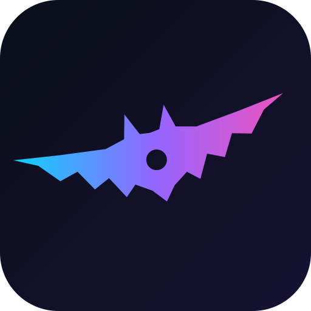
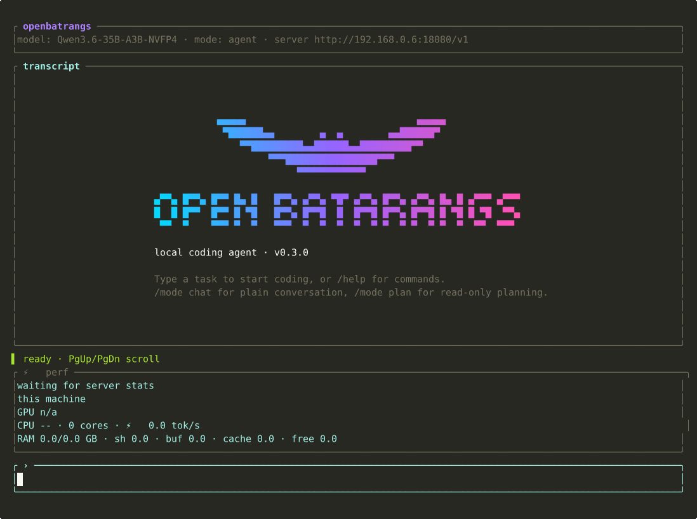

<div align="center">



# openbatrangs

A terminal coding agent for local language models, on any hardware.

[](https://github.com/arpanpathak/openbatrangs/actions/workflows/ci.yml)
[](https://github.com/arpanpathak/openbatrangs/actions/workflows/ci.yml)
[](https://github.com/arpanpathak/openbatrangs/releases)
[](https://crates.io/crates/openbatrangs)
[](LICENSE)

[](https://doc.rust-lang.org/edition-guide/rust-2024/)
[](#install)
[](#install)
[](https://colab.research.google.com/github/arpanpathak/openbatrangs/blob/main/colab/openbatrangs.ipynb)



</div>

## Your model, your hardware, no subscription

You don't need a Claude subscription or any other paid coding assistant for
agentic coding. Serve an open model such as Qwen3-Coder, Gemma 4 or Nemotron on
your own GPU, or on a GPU cloud VM rented by the hour, and run openbatrangs on
your laptop against it. Your code stays on machines you control, and you pay
only for the hardware or the VM time.

- **Engines:** TensorRT Edge-LLM, TensorRT-LLM, vLLM, SGLang, llama.cpp, Ollama,
  and any server with OpenAI's chat completions API.
- **Hardware:** Linux on x86_64 and ARM64, and macOS on Apple silicon and Intel.
- **Agent loop:** one tool call per step, up to 40 steps. Tools for listing,
  reading, searching, writing and editing files, running shell commands, and
  searching the web.
- **Modes:** `agent` with every tool, `plan` with read-only tools, and `chat`
  with none.
- **Safety:** a `y` or `n` prompt before each file write and shell command in
  the terminal UI, and with `--confirm` for one-shot tasks. `--read-only` for
  no writes or commands at all. Every command runs in the operating system's
  sandbox, which lets it write only inside the project folder: bubblewrap
  (`bwrap`) on Linux and `sandbox-exec` on macOS. Where neither works, you
  approve each command. Commands that delete or reset files, such as `rm` or
  `git reset --hard`, always ask first. Every command also runs with `$HOME`
  and tool caches inside the project's `.agent/` folder, without keyboard
  input, and under a timeout.
- **Web search:** `web_search` and `web_read` through a
  [SearXNG](https://github.com/searxng/searxng) instance.
- **Folded steps:** one line per step with a title, the model and the time
  taken. Open a step for its reasoning, its decision and each tool call with
  its result, then open those for the full text.
- **Markdown answers:** headings, lists, tables, links and highlighted code.
- **Live server stats:** the model server's GPU utilization, power, temperature
  and memory from servers that publish `/v1/system`, such as
  [thor-tigress-agent](https://github.com/arpanpathak/thor-thunder-tigress-platform),
  or running requests and KV-cache use from vLLM, SGLang and llama.cpp
  `/metrics`, with this machine's CPU, memory and tokens per second below them.
- **Terminal UI:** slash commands and a model picker. Click a step to fold it,
  or press Tab to reach the transcript, the arrow keys to choose a step, and
  Enter to fold it.
- **Reasoning display:** the reasoning of thinking models such as Qwen3 and
  Nemotron, dimmed before each step, or hidden with `--no-think`.

## Engines

| | Engine | Option |
|---|---|---|
|  | [TensorRT Edge-LLM](https://github.com/NVIDIA/TensorRT-Edge-LLM) | `--openai-url` |
|  | [TensorRT-LLM](https://github.com/NVIDIA/TensorRT-LLM) | `--openai-url` |
| <picture><source media="(prefers-color-scheme: dark)" srcset="assets/engines/vllm-dark.png"></picture> | [vLLM](https://github.com/vllm-project/vllm) | `--openai-url` |
|  | [SGLang](https://github.com/sgl-project/sglang) | `--openai-url` |
|  | [llama.cpp](https://github.com/ggml-org/llama.cpp) | `--openai-url` |
| <picture><source media="(prefers-color-scheme: dark)" srcset="assets/engines/ollama-dark.png"></picture> | [Ollama](https://ollama.com) | `--ollama-url` |

The logos belong to their owners. Their sources are listed in
[`assets/engines/README.md`](assets/engines/README.md).

## Install

Install openbatrangs on Linux or macOS with one command.

```sh
curl -fsSL https://github.com/arpanpathak/openbatrangs/releases/latest/download/install.sh | sh
```

You get the release binary for your system and architecture, checked against
the release's SHA-256 checksums, in `~/.local/bin`, or in `/usr/local/bin` when
you run the installer as root. To choose another version or folder, set these
two variables.

```sh
curl -fsSL https://github.com/arpanpathak/openbatrangs/releases/latest/download/install.sh \
  | OPENBATRANGS_VERSION=v0.2.3 OPENBATRANGS_INSTALL_DIR=/opt/bin sh
```

Run the same command again to update, or run `openbatrangs update`. Once a day,
openbatrangs checks GitHub for a newer release, and you see a prompt to install
it. To turn the check off, pass `--no-update-check` or set
`OPENBATRANGS_NO_UPDATE_CHECK=1`.

To download a binary yourself, pick the file for your system from the
[latest release](https://github.com/arpanpathak/openbatrangs/releases/latest).

| System | File |
|---|---|
| Linux, x86_64 | `openbatrangs-x86_64-unknown-linux-gnu` |
| Linux, ARM64 | `openbatrangs-aarch64-unknown-linux-gnu` |
| macOS, Apple silicon | `openbatrangs-aarch64-apple-darwin` |
| macOS, Intel | `openbatrangs-x86_64-apple-darwin` |

With Rust installed through [rustup](https://rustup.rs), you can install the
same release from crates.io.

```sh
cargo install openbatrangs --locked
```

To build the latest code from GitHub, run the command below.
`rust-toolchain.toml` pins Rust 1.100.0, and you get that version through
rustup on the first build.

```sh
cargo install --git https://github.com/arpanpathak/openbatrangs --locked
```

## Quick start

Start a model server on your GPU machine, then point openbatrangs at it from
any machine that can reach it. In these examples, you serve Qwen3-Coder
30B-A3B, a coding model with tool calling, or Qwen3.6 35B-A3B on TensorRT
Edge-LLM. On a GPU cloud VM, open the port in its firewall, or forward it over
SSH with `ssh -N -L 8000:127.0.0.1:8000 gpu-vm`.

### TensorRT Edge-LLM

```sh
tensorrt-edgellm-serve ~/models/Qwen3.6-35B-A3B-NVFP4 --host 0.0.0.0 --port 8000 \
  --served-model-name Qwen3.6-35B-A3B-NVFP4 --reasoning-parser qwen3 \
  --tool-call-parser qwen3_xml --enable-auto-tool-choice
openbatrangs --openai-url http://gpu-vm:8000/v1
```

### TensorRT-LLM

```sh
trtllm-serve Qwen/Qwen3-Coder-30B-A3B-Instruct --host 0.0.0.0 --port 8000
openbatrangs --openai-url http://gpu-vm:8000/v1
```

### vLLM

```sh
vllm serve Qwen/Qwen3-Coder-30B-A3B-Instruct --port 8000 \
  --enable-auto-tool-choice --tool-call-parser qwen3_coder
openbatrangs --openai-url http://gpu-vm:8000/v1
```

### SGLang

```sh
python -m sglang.launch_server --model-path Qwen/Qwen3-Coder-30B-A3B-Instruct \
  --host 0.0.0.0 --port 8000 --tool-call-parser qwen3_coder
openbatrangs --openai-url http://gpu-vm:8000/v1
```

### llama.cpp

```sh
llama-server -m Qwen3-Coder-30B-A3B-Instruct-Q4_K_M.gguf --jinja --host 0.0.0.0 --port 8000
openbatrangs --openai-url http://gpu-vm:8000/v1
```

### Ollama

```sh
ollama pull qwen3-coder:30b
openbatrangs --model qwen3-coder:30b
```

Without `--openai-url`, you connect to Ollama at `http://localhost:11434`. If
Ollama is installed but not running, `ollama serve` is started for you. To
install Ollama and download a coding model, run `openbatrangs setup`. With
`openbatrangs list-models`, you see a score for agentic coding on your hardware
for each installed model.

### Google Colab

You can try openbatrangs on a Colab GPU without installing anything on your
own machine. Open
[`colab/openbatrangs.ipynb`](https://colab.research.google.com/github/arpanpathak/openbatrangs/blob/main/colab/openbatrangs.ipynb),
choose a GPU runtime under Runtime → Change runtime type, and run the cells in
order. The notebook installs openbatrangs and Ollama, downloads a model, clones
a repository and runs one task.

Pick the model by the GPU you get. A small model writes code well but often
loses track of a task with many steps, so use the largest model that fits.

| GPU | Memory | Model | `--max-ctx` |
| --- | --- | --- | --- |
| T4 (free) | 16 GB | `gemma4:12b` | `32768` |
| A100 | 40 GB | `gemma4:26b` | `32768` |
| A100 or H100 | 80 GB | `gemma4:26b` | `65536` |

Set the model in the notebook's `MODEL` field. On a GPU with 40 GB or more,
pass `--max-ctx` to every openbatrangs command for a longer context:

```sh
!ollama pull gemma4:26b
!openbatrangs --no-sandbox --no-update-check --cwd /content/project --model gemma4:26b --max-ctx 65536 "your task"
```

Without `--max-ctx`, openbatrangs asks Ollama for a context window of at most
32,768 tokens. An OpenAI-compatible server gets the model's whole window,
because the server sets its window when it starts. Ollama reserves GPU memory for the whole window it is asked
for. With the 256K-token window of Gemma 4, a 16 GB GPU runs out of memory,
and Ollama moves the model partly or fully to the CPU, where a reply can take
minutes. To check where the model runs, run `!ollama ps` during a task. The
PROCESSOR column should say `100% GPU`.

The commands pass `--no-sandbox` because a Colab runtime is a throwaway
machine and usually can't run bubblewrap. Without the flag, you would approve
every shell command the model runs. Commands that delete or reset files still
ask first.

A notebook cell has no terminal, so the terminal UI can't start there. Open
Colab's terminal from the button at the bottom left, or with the notebook's
`colab-xterm` cell, and run the command without a task:

```sh
cd /content/project
openbatrangs --no-sandbox --model gemma4:26b --max-ctx 65536
```

On an H100, you can use vLLM instead of Ollama. The H100 runs FP8 weights
natively, and vLLM answers faster than Ollama on one large GPU. Skip the
notebook's Ollama cells and start the server in a cell:

```python
!pip -q install vllm

import subprocess

subprocess.Popen(
    ["vllm", "serve", "Qwen/Qwen3-Coder-30B-A3B-Instruct-FP8",
     "--enable-auto-tool-choice", "--tool-call-parser", "qwen3_coder"],
    stdout=open("/content/vllm.log", "w"), stderr=subprocess.STDOUT,
    start_new_session=True,
)
```

The first start downloads about 31 GB and takes several minutes. When
`/content/vllm.log` shows that the server is listening on port 8000, connect
to it:

```sh
!openbatrangs --no-sandbox --openai-url http://localhost:8000/v1 --model Qwen/Qwen3-Coder-30B-A3B-Instruct-FP8 --cwd /content/project "your task"
```

Installing vLLM replaces Colab's PyTorch with its own version, so use a fresh
runtime for it.

## Usage

```sh
openbatrangs --openai-url http://gpu-vm:8000/v1                          # open the terminal UI
openbatrangs --openai-url http://gpu-vm:8000/v1 "fix the failing test"   # run one task and exit
openbatrangs --openai-url http://gpu-vm:8000/v1 --confirm "update the CLI docs"
openbatrangs --openai-url http://gpu-vm:8000/v1 --read-only "suggest a refactoring plan"
openbatrangs --openai-url https://gpu-vm.example.com/v1 --api-key-file ~/.config/gpu-vm/key
openbatrangs update                                                      # install the latest release
```

| Option | Effect |
|---|---|
| `--openai-url <url>` | the server's base URL, including `/v1` |
| `--api-key-file <path>` | a file whose contents are sent as a bearer token |
| `--model <name>` | the model to use, instead of the first one the server lists |
| `--cwd <path>` | the project folder, instead of the current one |
| `--confirm` | a prompt before each file write and shell command |
| `--read-only` | no file writes or shell commands |
| `--no-sandbox` | shell commands without the sandbox, for a machine you can throw away |
| `--max-steps <n>` | the step limit, 40 by default |
| `--max-ctx <tokens>` | an upper limit on the context window, 32768 by default on Ollama |
| `--no-think` | thinking off, for thinking models |
| `--searxng-url <url>` | the SearXNG instance for web search |
| `--no-update-check` | no daily check for a newer release |

### Web search

For web search, run a SearXNG instance at `http://127.0.0.1:8888`, or point
`--searxng-url` or `OPENBATRANGS_SEARXNG_URL` at another one.

```sh
ssh -fN -L 18888:127.0.0.1:8888 gpu-vm      # forward SearXNG from a remote machine
openbatrangs --searxng-url http://127.0.0.1:18888
```

## Terminal UI commands

| Command | Effect |
|---|---|
| `/help` | list the commands |
| `/status` | show the current settings and model |
| `/mode agent\|plan\|chat` | switch between every tool, read-only planning and plain chat |
| `/model <name>` | switch to another model |
| `/models` | open the model picker |
| `/read-only` | turn read-only mode on or off |
| `/confirm` | turn the prompt before writes and commands on or off |
| `/yolo` | turn off every prompt |
| `/thinking on\|off` | show or hide the model's reasoning |
| `/steps <n>` | set the step limit |
| `/cwd <path>` | change the project folder |
| `/perf` | show or hide the performance panel |
| `/mouse on\|off` | use the mouse wheel and scrollbar, or the terminal's own text selection |
| `/clear` | clear the transcript |
| `/pull <tag>`, `/setup`, `/doctor` | download a model, install Ollama, or check it (Ollama only) |
| `/exit`, `/quit` | leave openbatrangs |

Press Ctrl+C to stop a running task, then type a correction to continue the same
conversation.

On macOS, the performance panel stays empty. Its GPU figures are read from
`tegrastats` or `nvidia-smi`, and its CPU and memory figures from `/proc`.

## Development

```sh
cargo test
cargo clippy --all-targets
cargo llvm-cov --summary-only               # line coverage
```

For the development setup and the pull request guidelines, see
[CONTRIBUTING.md](CONTRIBUTING.md).

## License

openbatrangs is licensed under the [GNU Affero General Public License v3.0](LICENSE).
